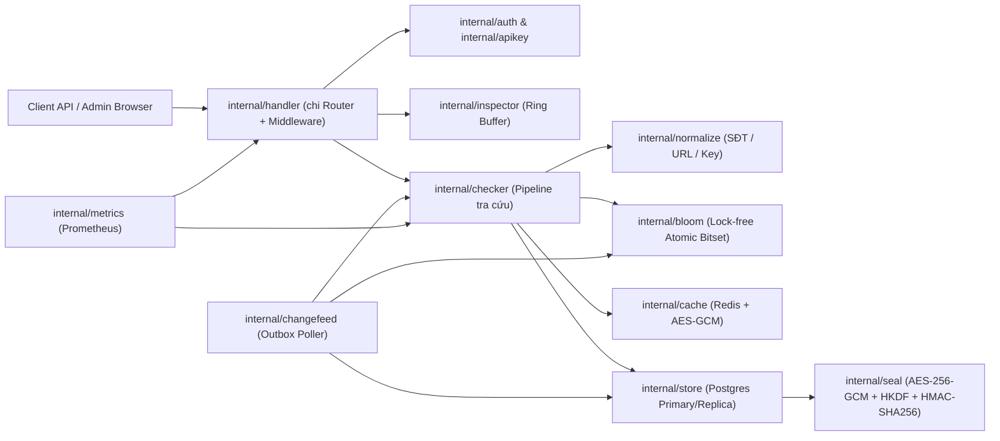
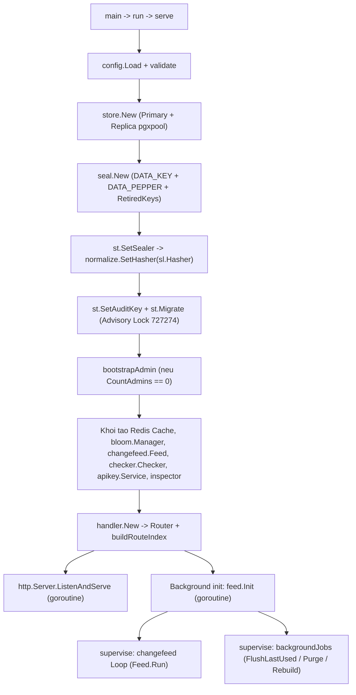
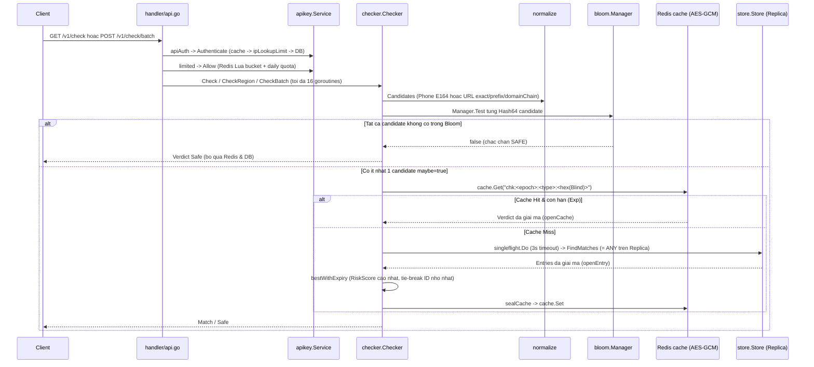
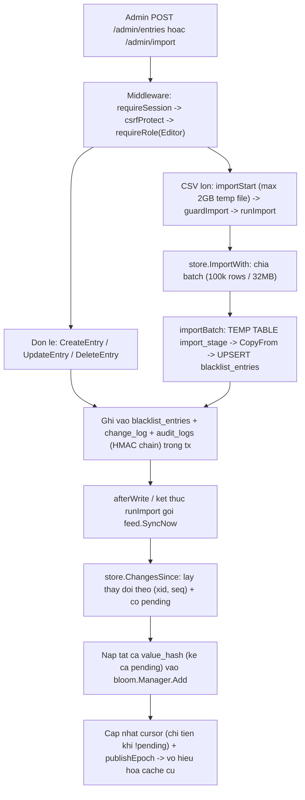

# Bản Đồ Hệ Thống VSF: Luồng Chạy & Toàn Bộ Hàm Trong Dự Án

Tài liệu này giúp bạn nắm được **2 thứ cốt lõi** của dự án `VSF` (Spam Blacklist):
1. **Phần 1 — Các luồng chạy chính (End-to-End Flows)**: dữ liệu đi qua các tầng nào từ lúc khởi động server, nhận request, tra cứu, ghi dữ liệu cho đến đồng bộ cache/Bloom và vận hành CLI.
2. **Phần 2 — Từ điển toàn bộ 44 file Go & mọi hàm/method**: hàm nào nằm ở file/dòng nào, ai gọi nó và nó làm gì.
---

## Phần 1: Kiến Trúc & 5 Luồng Chạy Chính

### Tổng quan kiến trúc các tầng (Layers)

---

### Luồng 1: Khởi động Server & Vòng đời Chạy nền (`cmd/server`)

Khi chạy server, hàm [`main`](../cmd/server/main.go#L31) khởi tạo logger JSON rồi gọi [`run`](../cmd/server/main.go#L40) (lắng nghe `SIGINT`/`SIGTERM`) -> [`serve`](../cmd/server/main.go#L48) thực hiện tuần tự:

**Điểm quan trọng cần nhớ:**
- Khi [`SetSealer`](../internal/store/sealed.go#L16) được gọi ở bước khởi động, nó đồng thời gọi [`normalize.SetHasher`](../internal/normalize/key.go#L48) để gắn HMAC-SHA256 vào [`MakeKey`](../internal/normalize/key.go#L51). Từ đó mọi hash lookup đều dùng `DATA_PEPPER` qua HMAC-SHA256 thay vì fallback `xxhash`.
- [`Migrate`](../internal/store/store.go#L103) chạy dưới lock Postgres `pg_advisory_lock(727274)` gồm: SQL migrations -> [`convertToSealed`](../internal/store/sealmigrate.go#L29) -> [`VerifyKeys`](../internal/store/keys.go#L79) -> [`runURLPathMigration`](../internal/store/urlmigrate.go#L50).
- Hai vòng lặp nền (`changefeed` và `backgroundJobs`) đều chạy qua [`supervise`](../cmd/server/supervise.go#L26) / [`runGuarded`](../cmd/server/supervise.go#L42): nếu bị panic sẽ recover, tăng metric `BackgroundPanics`, nghỉ `5s` (`loopRestartDelay`) rồi tự khởi động lại.
- Khi tắt server (`shutCtx` tối đa 15s), server gọi [`FlushLastUsed`](../internal/apikey/apikey.go#L321) rồi `srv.Shutdown`.

---

### Luồng 2: Tra cứu Public API (`/v1/check` & `/v1/check/batch`)

Đây là **hot read path** chịu tải cao nhất của hệ thống:

**Điểm thiết kế hay:**
- Trong `CheckBatch`, từng phần tử chạy qua [`checkItem`](../internal/checker/checker.go#L270) có `recover()` riêng nên 1 item lỗi panic không làm sập cả batch hay request.
- Cache key chứa `epoch := feed.Epoch()` nên khi dữ liệu thay đổi và `epoch` đổi, toàn bộ cache cũ tự động mất hiệu lực ngay lập tức mà không cần xóa key trên Redis.
- Dữ liệu lưu trong Redis cũng được mã hóa AES-256-GCM bởi [`sealCache`](../internal/checker/checker.go#L297) với `cacheAAD = "check-cache"`.

---

### Luồng 3: Ghi/Import Blacklist & Đồng bộ Changefeed -> Bloom -> Cache

Khi Admin thêm/sửa/xóa 1 entry hoặc import cả file CSV lớn:

**Ghi chú vận hành:**
- [`ChangesSince`](../internal/store/changes.go#L41) tính cột `pending = xid >= pg_snapshot_xmin(pg_current_snapshot())`. Nhờ đó [`SyncNow`](../internal/changefeed/changefeed.go#L172) nạp ngay các row vừa commit (kể cả khi còn transaction khác mở trước nó) vào Bloom để không bị missed detection, trong khi cursor persistent `(f.xid, f.seq)` vẫn giữ phía sau `xmin` để không bỏ sót transaction chưa commit sau này.
- Định kỳ theo `BloomRebuildInterval` (mặc định 24h), [`backgroundJobs`](../cmd/server/main.go#L190) gọi [`Feed.Rebuild`](../internal/changefeed/changefeed.go#L148) -> [`Manager.Rebuild`](../internal/bloom/bloom.go#L116) để xây Bloom filter mới (loại bỏ các entry đã xóa/hết hạn) mà không chặn luồng đọc nhờ double-buffering + hàng đợi `pending`.

---

### Luồng 4: Xác thực Admin, RBAC, CSRF, Audit Chain & Live Inspector

- **Đăng nhập Admin**: [`loginSubmit`](../internal/handler/admin_auth.go#L47) kiểm tra `sameOrigin`, đọc cookie thiết bị tin cậy (`VerifyDevice`), siết 3 tầng throttle (`IP`, `email|IP`, `email`), áp dụng [`loginBackoff`](../internal/handler/admin_auth.go#L23) nếu không phải thiết bị tin cậy, chống timing attack khi email không tồn tại bằng [`BurnTime`](../internal/auth/auth.go#L82), rồi verify mật khẩu Argon2id (`VerifyPassword`).
- **Session & RBAC**: Mọi route `/admin/*` sau login đi qua [`requireSession`](../internal/handler/middleware.go#L174) (idle timeout 30m, absolute timeout 12h), [`csrfProtect`](../internal/handler/middleware.go#L246) (cho POST/PUT/PATCH/DELETE), và [`requireRole`](../internal/handler/middleware.go#L217) theo 3 cấp (`Viewer=1`, `Editor=2`, `Admin=3`).
- **Audit Chain**: Mọi thao tác quan trọng ghi vào `audit_logs` thông qua [`writeAudit`](../internal/store/auditchain.go#L82) được tuần tự hóa bằng `pg_advisory_xact_lock(727275)` và băm nối chuỗi với bản ghi trước qua HMAC-SHA256 ([`auditHash`](../internal/store/auditchain.go#L58)). Admin có thể bấm kiểm tra toàn vẹn qua [`auditVerify`](../internal/handler/admin_manage.go#L314). Dữ liệu nhạy cảm trước khi lưu audit được che bởi [`auditView`](../internal/store/sealed.go#L62).
- **Live Inspector**: Middleware [`instrument`](../internal/handler/middleware.go#L98) ghi nhận HTTP request vào ring buffer [`inspector.Inspector`](../internal/inspector/inspector.go#L52) (đã che `X-API-Key`, `Authorization`, password, CSRF token). Ở chế độ dev, [`lookupHandlerSource`](../internal/handler/admin_inspector_source.go#L74) dùng `go/parser` + `go/ast` đọc trực tiếp source code hàm handler tương ứng để hiển thị trên UI.

---

### Luồng 5: Các công cụ CLI Bảo trì & Kiểm thử (`cmd/*`, `internal/testutil`)

- **Xoay `DATA_KEY` online (`cmd/rekey`)**: Server vẫn chạy bình thường. [`runContext`](../cmd/rekey/main.go#L46) dùng `DATA_KEY` mới + các key cũ trong `DATA_KEY_V<n>`, kiểm tra [`VerifyKeys`](../internal/store/keys.go#L79), rồi gọi [`Rekey`](../internal/store/keys.go#L242) mã hóa lại theo từng batch các dòng có `key_version <> current`.
- **Xoay `DATA_PEPPER` offline (`cmd/rotate-pepper`)**: Cần tắt toàn bộ server (`-servers-stopped`), đặt `DATA_PEPPER_OLD` và `DATA_PEPPER` mới, rồi [`run`](../cmd/rotate-pepper/main.go#L39) gọi [`RotatePepper`](../internal/store/pepper.go#L45) tính lại `value_hash` và `value_blind` (Postgres tự chuyển partition).
- **Sinh dữ liệu & Load test**: `cmd/gencsv` sinh CSV mẫu, `cmd/bench` bắn tải `single` hoặc `batch` theo phân phối `uniform` hoặc `zipf` và đọc `/metrics` để tính cache hit ratio.
- **Giả lập đứt mạng DB khi test**: `internal/testutil/pgfault` proxy TCP theo số round-trip hoặc byte của Postgres wire protocol.

---

## Phần 2: Danh Mục Toàn Bộ 44 File & Mọi Hàm Trong Hệ Thống

### 1. Nhóm `cmd/` (Các chương trình thực thi)

#### [`cmd/server/main.go`](../cmd/server/main.go)
- [`main`](../cmd/server/main.go#L31): Entrypoint của HTTP server, tạo `slog.Logger` JSON ghi ra `os.Stdout` và gọi `run(log)`.
- [`run`](../cmd/server/main.go#L40): Bọc context lắng nghe `os.Interrupt`/`syscall.SIGTERM` rồi gọi `serve`.
- [`serve`](../cmd/server/main.go#L48): Lắp ráp toàn bộ hệ thống (config -> store -> sealer -> migrate -> admin bootstrap -> Redis/Noop cache -> bloom -> changefeed -> checker -> apikey -> metrics -> inspector -> handler), bật HTTP server + 2 vòng lặp nền có giám sát, và xử lý graceful shutdown (timeout 15s).
- [`backgroundJobs`](../cmd/server/main.go#L190): Được `serve` chạy trong goroutine giám sát; gom các ticker định kỳ: flush `last_used_at` API key mỗi `1m` (`flushEvery`), dọn `change_log` (quá 24h) & session hết hạn (30m) mỗi `1h` (`purgeEvery`), và rebuild Bloom filter theo `cfg.BloomRebuildInterval`.
- [`bootstrapAdmin`](../cmd/server/main.go#L228): Được `serve` gọi lúc khởi động; chỉ tạo tài khoản Admin đầu tiên nếu `CountAdmins == 0`, có kiểm tra `len(BootstrapPass) >= auth.MinPasswordLen` (10 ký tự).

#### [`cmd/server/supervise.go`](../cmd/server/supervise.go)
- [`supervise`](../cmd/server/supervise.go#L26): Vòng lặp bọc cho `changefeed` và `backgroundJobs` (gọi từ `serve`); cứ sau `delay` (`loopRestartDelay = 5s`) lại khởi động lại tác vụ nếu chưa bị cancel.
- [`runGuarded`](../cmd/server/supervise.go#L42): Hàm nội bộ của `supervise`, chạy `fn(ctx)` trong `defer recover()` để bắt panic và tăng `metrics.BackgroundPanics`.

#### [`cmd/bench/main.go`](../cmd/bench/main.go)
- [`main`](../cmd/bench/main.go#L156): Entrypoint của công cụ load test HTTP, gọi `run`.
- [`run`](../cmd/bench/main.go#L163): Parse flag (`-url`, `-key`, `-file`, `-c` mặc định 64, `-d` 20s, `-hit` 0.1, `-seed`, `-dist`, `-zipf-s`, `-mode`, `-batch`, `-metrics-url`), spawn worker bắn API `/v1/check` hoặc `/v1/check/batch` và tổng hợp kết quả.
- [`resolveSeed`](../cmd/bench/main.go#L26): Dùng bởi `run` để chọn seed ngẫu nhiên hoặc cố định cho phép thử.
- [`workerSeed`](../cmd/bench/main.go#L35): Sinh seed riêng cho từng goroutine worker trong `run`.
- [`newPicker`](../cmd/bench/main.go#L39): Trả về hàm chọn key theo phân phối `"uniform"` hoặc `"zipf"` (`s > 1`).
- [`classify`](../cmd/bench/main.go#L62): Phân loại lỗi mạng/timeout để thống kê trong báo cáo benchmark.
- [`fetchLayers`](../cmd/bench/main.go#L137): Gọi endpoint `/metrics` trước và sau khi chạy bench, dùng [`parseLayers`](../cmd/bench/main.go#L97) (regex `vsf_check_layer_total`), [`layerDelta`](../cmd/bench/main.go#L116) và [`cacheHitRatio`](../cmd/bench/main.go#L127) để tính tỷ lệ trúng từng tầng (Bloom / Cache / DB).

#### [`cmd/gencsv/main.go`](../cmd/gencsv/main.go)
- [`main`](../cmd/gencsv/main.go#L13): Sinh file CSV dữ liệu giả (`-n` 1,000,000 dòng, `-out`, `-url`, `-seed`) gồm các cột `type,value,match_type,category,risk_score,source,note` để test import hoặc bench.

#### [`cmd/rekey/main.go`](../cmd/rekey/main.go)
- [`main`](../cmd/rekey/main.go#L30): Entrypoint CLI xoay `DATA_KEY` online, gọi [`run`](../cmd/rekey/main.go#L38) -> [`runContext`](../cmd/rekey/main.go#L46).
- [`runContext`](../cmd/rekey/main.go#L46): Load config, mở store + sealer (kèm `RetiredKeys`), hỗ trợ flag `-status`, `-dry-run`, `-batch` (mặc định 5000); chạy `st.VerifyKeys` rồi gọi `st.Rekey`.
- [`printStatus`](../cmd/rekey/main.go#L132): Gọi khi có `-status`; lấy `st.KeyVersionCounts` để in phân bố từng `key_version` trong DB và kiểm tra `sl.HasVersion`.

#### [`cmd/rotate-pepper/main.go`](../cmd/rotate-pepper/main.go)
- [`main`](../cmd/rotate-pepper/main.go#L31): Entrypoint CLI xoay `DATA_PEPPER` offline, gọi [`run`](../cmd/rotate-pepper/main.go#L39).
- [`run`](../cmd/rotate-pepper/main.go#L39): Bắt buộc `DATA_PEPPER_OLD` khác `DATA_PEPPER` và cờ `-servers-stopped` (trừ `-dry-run`); tạo `oldSealer` & `newSealer` rồi gọi `st.RotatePepper` dùng `oldSealer.Blind`.

---

### 2. Nhóm Cấu hình, Model & Metrics

#### [`internal/config/config.go`](../internal/config/config.go)
- [`Load`](../internal/config/config.go#L77): Đọc biến môi trường, áp giá trị mặc định (`APP_ENV=development`, `PG_MAX_CONNS=32`, `CACHE_TTL=10m`, `DEFAULT_REGION=VN`, `BLOOM_EXPECTED_ITEMS=10_000_000`, `BLOOM_REBUILD_INTERVAL=24h`, `POLL_INTERVAL=1s`, `RATE_LIMIT_RPS=100`, `DATA_KEY_VERSION=1`...) và chạy `validate()`.
- [`ParseCIDRs`](../internal/config/config.go#L135): Parse chuỗi `TRUSTED_PROXIES` thành danh sách `*net.IPNet`.
- [`retiredDataKeys`](../internal/config/config.go#L171): Quét biến môi trường khớp regex `^DATA_KEY_V(\d+)$` (version `1..math.MaxInt16`) để nạp key cũ phục vụ giải mã đa phiên bản.
- [`validate`](../internal/config/config.go#L205): Kiểm tra chặt chẽ bảo mật (ở `production`: bắt buộc `SessionSecret >= 32`, `CookieSecure=true`, `!AuthDisabled`, có `TrustedProxies` hoặc `NoProxy=true`, DB bật TLS; chung: `DataKey >= 32`, `DataPepper >= 32`, `DataKey != DataPepper`, `AuthDisabled` chỉ cho phép trên loopback...).
- [`dbTLSEnforced`](../internal/config/config.go#L269): Kiểm tra `sslmode` trong DSN Postgres là `require`/`verify-ca`/`verify-full`.
- [`isLoopbackAddr`](../internal/config/config.go#L293): Kiểm tra địa chỉ listen có phải loopback hay không.
- [`checkPositive`](../internal/config/config.go#L308): Validate số nguyên nằm trong `[1, max]`.
- [`getenv`](../internal/config/config.go#L317), [`getenvInt`](../internal/config/config.go#L326), [`getenvBool`](../internal/config/config.go#L337), [`getenvDuration`](../internal/config/config.go#L348): Bộ helper đọc env có fallback mặc định.
- [`Warnings`](../internal/config/config.go#L359): Trả danh sách cảnh báo cấu hình khi startup để log ra trong `serve`.
- [`KeyFingerprint`](../internal/config/config.go#L371): Tính fingerprint an toàn (8 byte đầu SHA-256 dạng hex) của key để log startup mà không lộ secret.

#### [`internal/model/model.go`](../internal/model/model.go)
- [`EntryInput.Validate`](../internal/model/model.go#L37): Validate dữ liệu đầu vào blacklist (mặc định `Category="spam"`, check thuộc `Categories`, `RiskScore` 0..100, `len(Source)<=200`, `len(Note)<=2000`). Được gọi ở handler và import.
- [`Role.Level`](../internal/model/model.go#L70): Quy đổi quyền thành cấp số (`Viewer=1`, `Editor=2`, `Admin=3`, sai=0).
- [`Role.AtLeast`](../internal/model/model.go#L86): Kiểm tra quyền hiện tại có `>= min` không (dùng trong middleware `requireRole`).
- [`ValidRole`](../internal/model/model.go#L89): Kiểm tra string role có hợp lệ khi tạo/sửa Admin user.

#### [`internal/metrics/metrics.go`](../internal/metrics/metrics.go)
- [`RegisterGauges`](../internal/metrics/metrics.go#L69): Được `cmd/server/main.go` gọi lúc startup để đăng ký các Gauge runtime (Bloom, Feed lag, DB pool...) theo cơ chế idempotent có mutex bảo vệ. Ngoài ra file khai báo sẵn các `Counter`/`Histogram` Prometheus dùng xuyên suốt `checker`, `handler`, `apikey`, `supervise`.

---

### 3. Nhóm Chuẩn hóa & Mã hóa (`normalize` & `seal`)

#### [`internal/normalize/key.go`](../internal/normalize/key.go)
- [`SetHasher`](../internal/normalize/key.go#L48): Gắn `Hasher` toàn cục bằng `atomic.Pointer` (được `store.SetSealer` gọi).
- [`MakeKey`](../internal/normalize/key.go#L51): Sinh `Key` chuẩn để tra cứu/lưu DB. Nếu đã cài `Hasher` (từ `seal`) thì tạo HMAC-SHA256 blind index, ngược lại fallback `xxhash.Sum64String(typ+"|"+matchType+"|"+value)`.

#### [`internal/normalize/phone.go`](../internal/normalize/phone.go)
- [`Phone`](../internal/normalize/phone.go#L10): Chuẩn hóa SĐT thô theo `region` (trim, tối đa 32 ký tự, parse qua `nyaruka/phonenumbers`, check `IsPossibleNumber`) về dạng `E.164`. Được `NormalizeEntry` và `Candidates` gọi.

#### [`internal/normalize/url.go`](../internal/normalize/url.go)
- [`URLParts.Host`](../internal/normalize/url.go#L23), [`URLParts.Full`](../internal/normalize/url.go#L37): Trả về phần host/port hoặc URL chuẩn hóa đầy đủ từ struct `URLParts`.
- [`isTracking`](../internal/normalize/url.go#L53): Nhận diện tham số tracking (`utm_*`, `fbclid`, `gclid`, `mc_cid`, `mc_eid`, `igshid`, `yclid`, `msclkid`) để loại bỏ.
- [`ParseURL`](../internal/normalize/url.go#L59): Hàm chuẩn hóa URL trung tâm (tối đa 2048 ký tự): đổi `\` thành `/`, chỉ nhận `http`/`https`, bỏ `www.` nếu còn dấu chấm, chuẩn hóa IPv4 cũ (`legacyIPv4`), IDNA `ToASCII`, bỏ port 80/443, chuẩn hóa path (`canonicalPath`), xóa tracking query param và sort query.
- [`domainChain`](../internal/normalize/url.go#L134): Sinh chuỗi domain từ host đầy đủ thu hẹp dần tới `eTLD+1` qua `publicsuffix`.
- [`pathPrefixes`](../internal/normalize/url.go#L160): Sinh danh sách tiền tố đường dẫn tăng dần (`host`, `host/a`, `host/a/b`...) phục vụ match kiểu `prefix`.
- [`canonicalPath`](../internal/normalize/url.go#L190): Unescape ký tự unreserved, bỏ `;param`, xử lý `.` và `..`, lowercase ASCII (nhờ bộ helper [`isHex`](../internal/normalize/url.go#L248), [`unhex`](../internal/normalize/url.go#L253), [`isUnreserved`](../internal/normalize/url.go#L265)).
- [`backslashesToSlashes`](../internal/normalize/url.go#L275): Chuyển `\` thành `/` trước khi parse URL.
- [`legacyIPv4`](../internal/normalize/url.go#L291) & [`parseIPv4Part`](../internal/normalize/url.go#L332): Giải mã các IPv4 viết tắt/hex/octal (chống lách luật URL).

#### [`internal/normalize/normalize.go`](../internal/normalize/normalize.go)
- [`NormalizeEntry`](../internal/normalize/normalize.go#L6): Dùng khi **tạo/sửa/import** 1 blacklist entry; kiểm tra rule lưu DB (SĐT chỉ nhận `exact`; URL `domain` chỉ giữ host, `prefix` giữ host+path không query, `exact` giữ `Full`) và trả về `Key` duy nhất để lưu.
- [`Candidates`](../internal/normalize/normalize.go#L58): Dùng khi **tra cứu** (`checker.CheckRegion`); sinh mọi `Key` ứng viên có thể khớp (với URL sinh đủ `exact`, các `pathPrefixes` dạng `prefix`, và `domainChain` dạng `domain`).
- [`CanonicalURLValue`](../internal/normalize/normalize.go#L94): Dùng bởi `store/urlmigrate.go` để chuẩn hóa lại giá trị URL đã có sẵn trong DB.

#### [`internal/seal/seal.go`](../internal/seal/seal.go)
- [`WithRetiredKeys`](../internal/seal/seal.go#L53): Option truyền map key các phiên bản cũ vào `seal.New`.
- [`aeadFor`](../internal/seal/seal.go#L56) & [`derive`](../internal/seal/seal.go#L145): Dùng HKDF-SHA256 (`info = "vsf-data-encryption-v1"` cho AES-256-GCM AEAD, và `"vsf-blind-index-v1"` cho khóa HMAC blind index).
- [`New`](../internal/seal/seal.go#L71): Khởi tạo `Sealer` với `dataKey`, `pepper`, `version` và các retired keys; yêu cầu secret tối thiểu 32 byte (`minSecretLen`).
- [`Version`](../internal/seal/seal.go#L155), [`Versions`](../internal/seal/seal.go#L158), [`HasVersion`](../internal/seal/seal.go#L170): Kiểm tra phiên bản key đang cấu hình (dùng ở `rekey` và `VerifyKeys`).
- [`Seal`](../internal/seal/seal.go#L176): Sinh ngẫu nhiên nonce 12-byte và mã hóa AES-256-GCM kèm AAD (`AADValue="value"`, `AADNote="note"`, `AADSource="source"`, hoặc `"check-cache"`). Trả về format `nonce(12B) || ciphertext+tag`.
- [`Open`](../internal/seal/seal.go#L189): Giải mã bằng key hiện tại (dùng cho Redis cache).
- [`OpenVersion`](../internal/seal/seal.go#L194) & [`openWith`](../internal/seal/seal.go#L204): Giải mã theo `key_version` lưu trong từng dòng DB (`store.openEntry`, `VerifyKeys`, `Rekey`); trả `ErrUnknownKeyVersion` nếu thiếu key cũ.
- [`Blind`](../internal/seal/seal.go#L219): Tính HMAC-SHA256 theo định dạng có prefix độ dài cho `(typ, matchType, value)`.
- [`Hash64`](../internal/seal/seal.go#L233): Lấy 8 byte đầu big-endian của blind digest ép về `int64` làm `value_hash` (dùng chia partition DB & đưa vào Bloom filter).
- [`Mask`](../internal/seal/seal.go#L238): Che chuỗi nhạy cảm (giữ 3 ký tự đầu + `***` + 2 ký tự cuối, hoặc `1***` nếu dài <= 6) phục vụ `auditView`.
- [`Hasher`](../internal/seal/seal.go#L253): Trả về adapter thực thi `normalize.Hasher` để gắn vào `normalize.SetHasher`.

---

### 4. Nhóm Tăng tốc Tra cứu (`bloom`, `cache`, `changefeed`, `checker`)

#### [`internal/bloom/bloom.go`](../internal/bloom/bloom.go)
- [`New`](../internal/bloom/bloom.go#L21): Cấp phát `Filter` (`bitsPerItem=10`, `numHashes=7`, tối thiểu 1024 items).
- [`Filter.probe`](../internal/bloom/bloom.go#L31): Double hashing sinh 7 vị trí bit từ 1 hash 64-bit.
- [`Filter.Add`](../internal/bloom/bloom.go#L37): Bật bit bằng `atomic.OrUint64` (lock-free).
- [`Filter.Test`](../internal/bloom/bloom.go#L45): Đọc bit bằng `atomic.LoadUint64` (lock-free).
- [`Filter.SizeBytes`](../internal/bloom/bloom.go#L57): Trả kích thước RAM của bitset (dùng cho Prometheus gauge).
- [`NewManager`](../internal/bloom/bloom.go#L71): Tạo `Manager` bọc con trỏ `Filter` hiện tại + cơ chế rebuild không khóa đọc.
- [`Manager.Ready`](../internal/bloom/bloom.go#L74), [`Items`](../internal/bloom/bloom.go#L77), [`SizeBytes`](../internal/bloom/bloom.go#L80): Báo trạng thái cho `/readyz` và metrics.
- [`Manager.Test`](../internal/bloom/bloom.go#L89): Kiểm tra nhanh trong `checker.CheckRegion`. Trả `true` an toàn nếu Bloom chưa `Ready` để fallback xuống DB.
- [`Manager.Add`](../internal/bloom/bloom.go#L99): Thêm hash vào `cur`; nếu đang có `Rebuild` chạy song song thì đẩy thêm vào slice `pending` để không bị mất key mới.
- [`Manager.Rebuild`](../internal/bloom/bloom.go#L116): Được `changefeed.Rebuild` gọi; xây `fresh` filter ngoài luồng đọc, có `defer` dọn cờ `rebuilding` nếu panic, replay lại `pending`, rồi tráo con trỏ `m.cur`.

#### [`internal/cache/cache.go`](../internal/cache/cache.go)
- [`Noop.Get`](../internal/cache/cache.go#L20), [`Noop.Set`](../internal/cache/cache.go#L22): Cache rỗng khi không cấu hình Redis.
- [`NewRedis`](../internal/cache/cache.go#L32), [`Redis.Get`](../internal/cache/cache.go#L35), [`Redis.Set`](../internal/cache/cache.go#L51): Đọc/ghi Redis với timeout cứng `opTimeout = 50ms` và ghi nhận metric lỗi nếu Redis trục trặc (hệ thống vẫn chạy tiếp qua DB).

#### [`internal/changefeed/changefeed.go`](../internal/changefeed/changefeed.go)
- [`New`](../internal/changefeed/changefeed.go#L58): Khởi tạo `Feed` giữ con trỏ tới `store`, `bloom.Manager`, `slog.Logger`.
- [`Epoch`](../internal/changefeed/changefeed.go#L65): Được `checker` gọi để ghép vào Redis cache key.
- [`Lag`](../internal/changefeed/changefeed.go#L68), [`TailLen`](../internal/changefeed/changefeed.go#L79), [`StalledFor`](../internal/changefeed/changefeed.go#L83), [`TailOverflow`](../internal/changefeed/changefeed.go#L94): Cung cấp chỉ số đồng bộ cho `/readyz` và Prometheus gauges.
- [`mixSeq`](../internal/changefeed/changefeed.go#L97) & [`publishEpoch`](../internal/changefeed/changefeed.go#L107): Dùng splitmix64 tạo chuỗi epoch dạng `xid.seq` hoặc `xid.seq.t<len>-<fp>` mỗi khi có thay đổi mới (kể cả `Pending`).
- [`setCursor`](../internal/changefeed/changefeed.go#L123): Cập nhật vị trí `(f.xid, f.seq)` và publish epoch.
- [`Init`](../internal/changefeed/changefeed.go#L129): Gọi 1 lần khi startup: lấy `store.Head` -> `setCursor` -> gọi `Rebuild`.
- [`Rebuild`](../internal/changefeed/changefeed.go#L148): Tính sức chứa `max(expectedItems, EstimatedCount*1.3)`, đọc `store.AllHashes` để tái tạo toàn bộ Bloom filter.
- [`SyncNow`](../internal/changefeed/changefeed.go#L172): Được gọi định kỳ bởi `Run` và ngay sau mỗi thao tác ghi admin (`afterWrite`, `runImport`). Đọc batch tối đa 10,000 dòng từ `store.ChangesSince`, khử trùng lặp tail qua `f.tail`, nạp mọi `value_hash` (kể cả `Pending`) vào Bloom, nhưng chỉ đẩy cursor khi hết vùng pending (`defaultMaxTail = 1_000_000`).
- [`Run`](../internal/changefeed/changefeed.go#L260): Vòng lặp poll `SyncNow` theo `PollInterval`.

#### [`internal/checker/checker.go`](../internal/checker/checker.go)
- [`New`](../internal/checker/checker.go#L76): Khởi tạo `Checker` với vùng mặc định, `bloom.Manager`, `cache.Cache`, `finder`, `epoch`.
- [`SetCacheSealer`](../internal/checker/checker.go#L91): Gắn `seal.Sealer` để mã hóa/giải mã payload cache Redis.
- [`ValidRegion`](../internal/checker/checker.go#L102): Kiểm tra mã vùng SĐT có hợp lệ không (dùng ở `/v1/check`).
- [`Check`](../internal/checker/checker.go#L117): Shorthand gọi `CheckRegion` với `defaultRegion`.
- [`CheckRegion`](../internal/checker/checker.go#L123): Pipeline tra cứu đơn lẻ: `Candidates` -> `Bloom.Test` -> `Cache.Get` (check hết hạn `Exp`) -> `singleflight.Do` (dùng `context.WithoutCancel(ctx)` + timeout 3s) -> `finder.FindMatches` -> `bestWithExpiry` -> `sealCache` -> `Cache.Set`.
- [`finish`](../internal/checker/checker.go#L201): Helper hoàn thiện kết quả, ghi metric layer & latency.
- [`best`](../internal/checker/checker.go#L213) & [`bestWithExpiry`](../internal/checker/checker.go#L219): Chọn bản ghi match có `RiskScore` cao nhất (nếu bằng nhau chọn `ID` nhỏ nhất) và xác định thời điểm hết hạn sớm nhất cho cache.
- [`CheckBatch`](../internal/checker/checker.go#L238): Chạy song song tối đa 16 goroutines cho tối đa `MaxBatch = 100` item, giữ đúng thứ tự mảng kết quả.
- [`checkItem`](../internal/checker/checker.go#L270): Bọc `CheckRegion` với `defer recover()` để cô lập panic từng phần tử trong batch (tăng metric `CheckPanics`).
- [`sealCache`](../internal/checker/checker.go#L297) & [`openCache`](../internal/checker/checker.go#L307): Mã hóa/giải mã JSON cached verdict trong Redis bằng `cacheSealer` với `cacheAAD = "check-cache"`.

---

### 5. Nhóm Bảo mật, API Key & Live Inspector (`auth`, `apikey`, `inspector`)

#### [`internal/auth/auth.go`](../internal/auth/auth.go)
- [`HashPassword`](../internal/auth/auth.go#L31) & [`VerifyPassword`](../internal/auth/auth.go#L43): Băm và kiểm tra mật khẩu bằng Argon2id (`m=64MB`, `t=2`, `p=2`), hỗ trợ `MinPasswordLen = 10`.
- [`BurnTime`](../internal/auth/auth.go#L82): Chạy verify mật khẩu giả tốn thời gian cố định khi login sai email, chống side-channel dò email tồn tại.
- [`NewToken`](../internal/auth/auth.go#L85) & [`HashToken`](../internal/auth/auth.go#L96): Sinh token ngẫu nhiên 32 byte base64url (dùng cho session/CSRF) và băm SHA-256 trước khi lưu DB.
- [`NewThrottle`](../internal/auth/auth.go#L111), [`prune`](../internal/auth/auth.go#L116), [`Allowed`](../internal/auth/auth.go#L134), [`Fail`](../internal/auth/auth.go#L141), [`Count`](../internal/auth/auth.go#L156), [`Reset`](../internal/auth/auth.go#L164): Bộ đếm sliding-window in-memory (giới hạn map ở 100k entry bằng cách `prune`) dùng trong `admin_auth.go` để chặn brute-force theo IP / email.
- [`SignDevice`](../internal/auth/auth.go#L173), [`VerifyDevice`](../internal/auth/auth.go#L179), [`deviceMAC`](../internal/auth/auth.go#L199): Ký và kiểm tra cookie thiết bị tin cậy HMAC-SHA256 để user đăng nhập hợp lệ trước đó không bị phạt backoff khi đăng nhập lại.

#### [`internal/apikey/apikey.go`](../internal/apikey/apikey.go)
- [`randString`](../internal/apikey/apikey.go#L51) & [`Generate`](../internal/apikey/apikey.go#L71): Sinh API key mới chuẩn `vsf_<8>_<32>` (`prefixLen=8`, `secretLen=32`).
- [`HashSecret`](../internal/apikey/apikey.go#L86): Băm SHA-256 secret trước khi lưu Postgres.
- [`Parse`](../internal/apikey/apikey.go#L92): Tách prefix và secret từ raw API key.
- [`NewService`](../internal/apikey/apikey.go#L131): Khởi tạo service quản lý auth, cache và rate limit cho API key.
- [`Authenticate`](../internal/apikey/apikey.go#L139): Luồng xác thực API key: `Parse` -> `lookup` -> so sánh constant-time -> check trạng thái active/hết hạn -> đánh dấu `used[k.ID]` chờ flush.
- [`lookup`](../internal/apikey/apikey.go#L173): Kiểm tra positive cache (`30s`) / negative cache (`10s`); nếu miss thì qua `allowLookup(ctx, ip)` mới query `store.GetAPIKeyByPrefix`.
- [`allowLookup`](../internal/apikey/apikey.go#L225): Giới hạn tốc độ cache-miss lookup theo IP (`ipLookupRPS=10`, `ipLookupBurst=20`, key Redis `rl:ip:<ip>` hoặc map local tối đa `50,000` IP) chống spam key rác làm quá tải DB.
- [`Allow`](../internal/apikey/apikey.go#L258): Kiểm tra rate limit cho `units` (1 cho `/check`, N cho `/check/batch`) với `burst = max(rps, k.MaxBatch)` qua Redis Lua hoặc local `rate.Limiter`, sau đó gọi [`checkDailyQuota`](../internal/apikey/apikey.go#L297).
- [`tokenBucketLua`](../internal/apikey/apikey.go#L343) & [`redisAllow`](../internal/apikey/apikey.go#L370): Chạy Lua token-bucket trên Redis (timeout 50ms, fail-open + metric nếu Redis lỗi).
- [`FlushLastUsed`](../internal/apikey/apikey.go#L321): Đẩy batch ID các key vừa dùng xuống `store.TouchAPIKeys` (gọi mỗi phút & lúc shutdown).
- [`Invalidate`](../internal/apikey/apikey.go#L335): Xóa ngay cache in-memory khi Admin thu hồi (`apiKeyRevoke`) hoặc xoay key (`apiKeyRotate`).

#### [`internal/inspector/inspector.go`](../internal/inspector/inspector.go)
- [`New`](../internal/inspector/inspector.go#L52): Tạo ring buffer lưu request gần nhất (mặc định `capacity=200`).
- [`Record`](../internal/inspector/inspector.go#L63): Lưu bản ghi HTTP mới vào ring buffer sau khi gọi `MaskSensitive`.
- [`Clear`](../internal/inspector/inspector.go#L85), [`GetRecent`](../internal/inspector/inspector.go#L92), [`GetByID`](../internal/inspector/inspector.go#L154), [`GetStats`](../internal/inspector/inspector.go#L168), [`formatDuration`](../internal/inspector/inspector.go#L224): Đọc/lọc/xóa dữ liệu hiển thị lên màn hình Live Inspector (tính RPS trong 10s gần nhất).
- [`ExtractHeaders`](../internal/inspector/inspector.go#L235), [`RedactBody`](../internal/inspector/inspector.go#L268), [`MaskSensitive`](../internal/inspector/inspector.go#L289): Che giấu `X-API-Key`, `Authorization`, mật khẩu, token trước khi lưu vào ring buffer.
- [`ScreenOf`](../internal/inspector/inspector.go#L303): Ánh xạ URL route sang tên màn hình Admin UI hiển thị trên Inspector.

---

### 6. Nhóm Web Router, Middleware & Handler (`internal/handler`)

#### [`internal/handler/handler.go`](../internal/handler/handler.go)
- [`New`](../internal/handler/handler.go#L58): Tạo `Handler`, khởi tạo 3 login throttle (`IP=20/15m`, `User=5/15m`, `Mail=30/15m`), `importJobs`, tên cookie session (`vsf_session` hoặc `__Host-vsf_session`), và parse HTML templates từ `web.FS`.
- [`Router`](../internal/handler/handler.go#L102): Dựng toàn bộ cây route `chi` (public health/metrics, `/v1/*`, `/admin/*` phân quyền Viewer/Editor/Admin) rồi gọi `buildRouteIndex`.
- [`readyz`](../internal/handler/handler.go#L183): Endpoint `/readyz` kiểm tra Bloom Ready, `Feed.Lag <= 30s`, `!Feed.TailOverflow`, `Store.Ping`; chỉ trả chi tiết kỹ thuật khi gọi từ loopback.
- [`writeJSON`](../internal/handler/handler.go#L244), [`writeErr`](../internal/handler/handler.go#L251), [`serverError`](../internal/handler/handler.go#L406): Helper trả response JSON và xử lý lỗi 500.
- [`peerIP`](../internal/handler/handler.go#L256), [`inNets`](../internal/handler/handler.go#L266), [`clientIP`](../internal/handler/handler.go#L279): Xác định IP thật của client; chỉ tin `X-Forwarded-For` (đọc từ phải sang trái) khi `peerIP` nằm trong `TrustedProxies`.
- [`metricsAuth`](../internal/handler/handler.go#L315): Bảo vệ `/metrics` bằng Bearer `MetricsToken` hoặc chỉ cho loopback khi không cấu hình token.
- [`actorFrom`](../internal/handler/handler.go#L335), [`newPage`](../internal/handler/handler.go#L367), [`render`](../internal/handler/handler.go#L381), [`isHTMX`](../internal/handler/handler.go#L401): Helper dựng dữ liệu chung cho template Admin UI và phát hiện request HTMX.

#### [`internal/handler/middleware.go`](../internal/handler/middleware.go)
- [`securityHeaders`](../internal/handler/middleware.go#L38): Gắn header bảo mật (`CSP`, `X-Frame-Options`, `X-Content-Type-Options`, v.v.).
- [`statusWriter.WriteHeader`](../internal/handler/middleware.go#L70), [`Write`](../internal/handler/middleware.go#L79), [`Flush`](../internal/handler/middleware.go#L88), [`Unwrap`](../internal/handler/middleware.go#L95): Wrapper `http.ResponseWriter` giữ status code & hỗ trợ streaming (`Flush`/`ResponseController` khi export/import).
- [`instrument`](../internal/handler/middleware.go#L98): Ghi nhận metric HTTP, log `slog` và đẩy request vào `Inspector` (chỉ đọc trước tối đa 2048B body với các route `/admin` POST/PUT/PATCH không phải nội bộ Inspector).
- [`sessionFrom`](../internal/handler/middleware.go#L157), [`redirectToLogin`](../internal/handler/middleware.go#L163), [`requireSession`](../internal/handler/middleware.go#L174): Xác thực cookie session Admin (check disable, `sessionIdle=30m`, `sessionAbsolute=12h`), tự gia hạn `LastSeenAt` nếu quá 1 phút.
- [`requireRole`](../internal/handler/middleware.go#L217): Kiểm tra quyền `Role.AtLeast(min)` cho group route.
- [`sameOrigin`](../internal/handler/middleware.go#L232) & [`csrfProtect`](../internal/handler/middleware.go#L246): Chống CSRF cho các method ghi (`POST`/`PUT`/`PATCH`/`DELETE`) qua check Origin/Referer + token trong header `X-CSRF-Token` hoặc form `csrf_token`.
- [`clearCookie`](../internal/handler/middleware.go#L275): Xóa cookie session khi logout/hết hạn.
- [`templateFuncs`](../internal/handler/middleware.go#L280): Đăng ký các hàm phụ cho HTML template (`fmtTime`, `fmtTimePtr`, `expired`, `shorten`, `deref`, `lower`, `statusClass`, `latencyClass`).

#### [`internal/handler/api.go`](../internal/handler/api.go)
- [`requestIDKey`](../internal/handler/api.go#L21) & [`apiKeyFrom`](../internal/handler/api.go#L24): Lấy request ID và `APIKey` đã xác thực từ `context.Context`.
- [`apiAuth`](../internal/handler/api.go#L30): Middleware của `/v1/*`; đọc `X-API-Key` hoặc `Authorization: Bearer` (hoặc cấp dev key giả nếu bật `AuthDisabled`), gọi `APIKeys.Authenticate` rồi gắn key vào context.
- [`limited`](../internal/handler/api.go#L82): Gọi `APIKeys.Allow(ctx, key, units)`, trả `429` nếu vượt RPS hoặc daily quota.
- [`apiCheckOne`](../internal/handler/api.go#L111): Handler `GET /v1/check` -> tiêu thụ 1 unit qua `limited` -> gọi `Checker.CheckRegion`.
- [`apiCheckBatch`](../internal/handler/api.go#L133): Handler `POST /v1/check/batch` -> giới hạn body 1MB (`DisallowUnknownFields`), nhận 1..100 items, tiêu thụ `len(req.Items)` units qua `limited` -> gọi `Checker.CheckBatch`.

#### [`internal/handler/admin_auth.go`](../internal/handler/admin_auth.go)
- [`loginBackoff`](../internal/handler/admin_auth.go#L23): Tính thời gian sleep phạt khi login thất bại liên tiếp (bỏ qua nếu có cookie thiết bị tin cậy).
- [`deviceCookieName`](../internal/handler/admin_auth.go#L32): Trả tên cookie lưu trạng thái thiết bị tin cậy (`deviceTrustFor = 30d`).
- [`loginPage`](../internal/handler/admin_auth.go#L41): Render form đăng nhập `/admin/login`.
- [`loginSubmit`](../internal/handler/admin_auth.go#L47): Xử lý đăng nhập (kiểm tra `sameOrigin`, giới hạn 64KB form, check 3 throttle + `loginAlertAfter=10`, chống timing attack với `BurnTime`, kiểm tra Argon2id, tạo session + CSRF + cookie device + ghi audit).
- [`logout`](../internal/handler/admin_auth.go#L172): Xóa session khỏi DB, clear cookie và redirect.

#### [`internal/handler/admin_entries.go`](../internal/handler/admin_entries.go)
- [`actorOf`](../internal/handler/admin_entries.go#L19): Lấy thông tin `model.Actor` từ session hoặc trạng thái `AuthDisabled`.
- [`listEntries`](../internal/handler/admin_entries.go#L50): Hiển thị danh sách blacklist (phân trang keyset, tìm kiếm exact theo value đã chuẩn hóa).
- [`renderForm`](../internal/handler/admin_entries.go#L126), [`newEntryForm`](../internal/handler/admin_entries.go#L137), [`parseEntryForm`](../internal/handler/admin_entries.go#L142): Render và parse dữ liệu form thêm/sửa entry (kèm `Store.ParseExpiry` và `EntryInput.Validate`).
- [`createEntry`](../internal/handler/admin_entries.go#L173), [`entryID`](../internal/handler/admin_entries.go#L205), [`editEntryForm`](../internal/handler/admin_entries.go#L211), [`updateEntry`](../internal/handler/admin_entries.go#L238), [`deleteEntry`](../internal/handler/admin_entries.go#L270): Các handler CRUD entry cho Editor/Admin.
- [`afterWrite`](../internal/handler/admin_entries.go#L292): Gọi ngay `Feed.SyncNow` sau mỗi thao tác ghi để Bloom & cache Epoch cập nhật tức thì.
- [`userMessage`](../internal/handler/admin_entries.go#L299): Chuyển đổi lỗi kỹ thuật thành thông báo thân thiện cho người dùng Admin UI.
- [`checkPage`](../internal/handler/admin_entries.go#L311) & [`checkSubmit`](../internal/handler/admin_entries.go#L316): Trang tra cứu thử trong Admin UI (gọi trực tiếp `Checker.CheckRegion`).

#### [`internal/handler/admin_import.go`](../internal/handler/admin_import.go)
- [`importJob.view`](../internal/handler/admin_import.go#L57), [`newImportJobs`](../internal/handler/admin_import.go#L72), [`importJobs.add`](../internal/handler/admin_import.go#L75), [`importJobs.get`](../internal/handler/admin_import.go#L88): Quản lý lịch sử tối đa 20 job import gần nhất trong RAM để UI poll tiến độ.
- [`newCSVIterator`](../internal/handler/admin_import.go#L105), [`csvIterator.field`](../internal/handler/admin_import.go#L133), [`reject`](../internal/handler/admin_import.go#L144), [`Next`](../internal/handler/admin_import.go#L156), [`Err`](../internal/handler/admin_import.go#L212): Iterator đọc streaming từng dòng CSV từ file tạm, validate và thu thập mẫu dòng lỗi.
- [`importPage`](../internal/handler/admin_import.go#L215): Render trang `/admin/import`.
- [`importStart`](../internal/handler/admin_import.go#L220): Nâng write deadline lên `10m` (`importReadWindow`), stream file upload tối đa `2GB` (`maxUploadBytes=2<<30`) ra file tạm, tạo `importJob` rồi chạy nền `guardImport` -> `runImport`.
- [`guardImport`](../internal/handler/admin_import.go#L301) & [`cleanup`](../internal/handler/admin_import.go#L319): Bọc panic recovery cho goroutine import (chuyển job về trạng thái failed nếu panic) và xóa file tạm.
- [`runImport`](../internal/handler/admin_import.go#L326): Chạy tối đa 2h: mở file CSV -> `Store.ImportWith` -> gọi `Feed.SyncNow`.
- [`importStatus`](../internal/handler/admin_import.go#L381): Trả HTML/HTMX trạng thái tiến trình import cho UI polling.
- [`csvSafe`](../internal/handler/admin_import.go#L394): Ngăn lỗi CSV formula injection (Excel) khi export.
- [`exportCSV`](../internal/handler/admin_import.go#L414): Ghi audit `entry.export.start` TRƯỚC khi stream dữ liệu, tải từng chunk 10k dòng qua `Store.ExportBatch` (gia hạn `60s` write deadline mỗi batch), và luôn ghi `entry.export.end` trong `defer` bằng `context.WithoutCancel`.

#### [`internal/handler/admin_inspector.go`](../internal/handler/admin_inspector.go) & [`admin_inspector_source.go`](../internal/handler/admin_inspector_source.go)
- [`inspectorPage`](../internal/handler/admin_inspector.go#L121), [`inspectorFeed`](../internal/handler/admin_inspector.go#L36), [`inspectorStats`](../internal/handler/admin_inspector.go#L54), [`inspectorDetail`](../internal/handler/admin_inspector.go#L61), [`inspectorCloseDetail`](../internal/handler/admin_inspector.go#L105), [`inspectorClear`](../internal/handler/admin_inspector.go#L110): Các endpoint HTMX hiển thị live feed, thống kê, chi tiết request (kèm trace middleware + code handler) và xóa log Inspector.
- [`buildRouteIndex`](../internal/handler/admin_inspector_source.go#L37), [`funcName`](../internal/handler/admin_inspector_source.go#L54), [`shortFuncName`](../internal/handler/admin_inspector_source.go#L63): Gọi 1 lần lúc `Router()` để dùng `chi.Walk` lập chỉ mục route -> tên middleware + handler function.
- [`lookupHandlerSource`](../internal/handler/admin_inspector_source.go#L74) & [`lookupCached`](../internal/handler/admin_inspector_source.go#L84): Dùng `go/parser` + `go/ast` trích xuất thân hàm handler (tối đa 80 dòng) từ các file `.go` trong `internal/handler` và cache vào `sourceCache`.

#### [`internal/handler/admin_manage.go`](../internal/handler/admin_manage.go)
- [`auditPage`](../internal/handler/admin_manage.go#L26) & [`auditVerify`](../internal/handler/admin_manage.go#L314): Xem nhật ký audit và bấm xác minh toàn bộ chuỗi HMAC `Store.VerifyAuditChain`.
- [`usersPage`](../internal/handler/admin_manage.go#L58), [`renderUsers`](../internal/handler/admin_manage.go#L63), [`userCreate`](../internal/handler/admin_manage.go#L76), [`userUpdate`](../internal/handler/admin_manage.go#L120): Quản lý tài khoản Admin/Editor/Viewer (chặn Admin tự hạ quyền hoặc tự khóa chính mình).
- [`apiKeysPage`](../internal/handler/admin_manage.go#L165), [`renderAPIKeys`](../internal/handler/admin_manage.go#L170), [`createKey`](../internal/handler/admin_manage.go#L184), [`apiKeyCreate`](../internal/handler/admin_manage.go#L196), [`apiKeyRevoke`](../internal/handler/admin_manage.go#L241), [`apiKeyRotate`](../internal/handler/admin_manage.go#L268): Quản lý API key; `apiKeyRotate` tạo key mới có `RotatedFrom`, đặt hạn grace cho key cũ (mặc định 7 ngày) và gọi `APIKeys.Invalidate`.

---

### 7. Nhóm Database Store & Migration (`internal/store`)

#### [`internal/store/store.go`](../internal/store/store.go)
- [`New`](../internal/store/store.go#L35) & [`openPool`](../internal/store/store.go#L57): Tạo pool Postgres Primary và optional Replica (`maxConns <= 1000`).
- [`Close`](../internal/store/store.go#L85), [`Ping`](../internal/store/store.go#L94), [`PoolStats`](../internal/store/store.go#L97): Đóng pool, healthcheck cho `/readyz`, lấy thông số pool cho metrics.
- [`Migrate`](../internal/store/store.go#L103): Khóa `pg_advisory_lock(727274)`, chạy SQL files trong `migrationsFS`, gọi `convertToSealed` -> `VerifyKeys` -> `runURLPathMigration`.
- [`LastKeyCheck`](../internal/store/store.go#L192): Trả kết quả lần `VerifyKeys` gần nhất (dùng ở `serve`).
- [`isUniqueViolation`](../internal/store/store.go#L195) & [`mapNotFound`](../internal/store/store.go#L201): Chuẩn hóa lỗi Postgres (SQLSTATE `23505` và `pgx.ErrNoRows`).

#### [`internal/store/entries.go`](../internal/store/entries.go)
- [`scanEntry`](../internal/store/entries.go#L25) & [`scanEntryHash`](../internal/store/entries.go#L49): Đọc row SQL vào struct `model.Entry` và giải mã thông qua `openEntry`.
- [`logChange`](../internal/store/entries.go#L57): Ghi bản ghi vào outbox `change_log` ngay trong cùng transaction với thao tác entry.
- [`CreateEntry`](../internal/store/entries.go#L63), [`GetEntry`](../internal/store/entries.go#L118), [`UpdateEntry`](../internal/store/entries.go#L124), [`DeleteEntry`](../internal/store/entries.go#L177): CRUD cho bảng phân vùng `blacklist_entries`. Riêng `UpdateEntry` khóa dòng và mã hóa lại toàn bộ 3 cột sealed dưới `key_version` hiện hành. Mọi thao tác ghi đều đồng thời gọi `logChange` và `writeAudit`.
- [`ListEntries`](../internal/store/entries.go#L212): Phân trang keyset theo `id` cho trang Admin, hỗ trợ lọc chính xác qua `value_hash`/`value_blind`.
- [`FindMatches`](../internal/store/entries.go#L292): Hàm query nóng của `checker`: chạy trên `s.read` (Replica), dùng `= ANY(...)` trên `value_hash` để Postgres tỉa partition (partition pruning), sau đó đối chiếu chính xác bộ `(hash, type, match_type, blind)` trong Go và bỏ qua dòng đã hết hạn.
- [`AllHashes`](../internal/store/entries.go#L352) & [`EstimatedCount`](../internal/store/entries.go#L372): Cung cấp toàn bộ hash đang còn hiệu lực và ước lượng số dòng từ `pg_class` (`blacklist_entries_p%`) cho `changefeed.Rebuild`.
- [`ExportBatch`](../internal/store/entries.go#L380): Đọc keyset từng batch 10k dòng để stream CSV trong `exportCSV`.
- [`ParseExpiry`](../internal/store/entries.go#L403) & [`riskScore16`](../internal/store/entries.go#L419): Helper parse chuỗi thời gian hết hạn và ép `RiskScore` về `int16`.

#### [`internal/store/changes.go`](../internal/store/changes.go)
- [`Head`](../internal/store/changes.go#L11): Lấy vị trí mới nhất `(xid, seq)` khi `changefeed.Init` khởi động.
- [`ChangesSince`](../internal/store/changes.go#L41): Đọc các dòng đã commit sau `(afterXID, afterSeq)` sắp xếp theo `(change_log.xid, change_log.seq)` và đánh dấu `pending = xid >= pg_snapshot_xmin(pg_current_snapshot())`.
- [`PurgeChanges`](../internal/store/changes.go#L67): Xóa `change_log` cũ hơn TTL (gọi mỗi giờ từ `backgroundJobs`).

#### [`internal/store/import.go`](../internal/store/import.go)
- [`Import`](../internal/store/import.go#L56) & [`ImportWith`](../internal/store/import.go#L75): Ghi audit start/end, chia luồng CSV từ `csvIterator` thành nhiều batch ngắn (`defaultImportBatchRows = 100_000`, `defaultImportBatchBytes = 32MB`).
- [`readImportBatch`](../internal/store/import.go#L141): Chuẩn hóa, validate và mã hóa trước toàn bộ 1 batch trên RAM trước khi mở transaction DB.
- [`importBatch`](../internal/store/import.go#L181): Mở transaction ngắn: tạo `TEMP TABLE import_stage` -> nạp nhanh bằng `pgx CopyFrom` -> `INSERT INTO blacklist_entries ... ON CONFLICT DO UPDATE` -> chèn `change_log`.

#### [`internal/store/admins.go`](../internal/store/admins.go)
- [`scanAdmin`](../internal/store/admins.go#L14), [`CountAdmins`](../internal/store/admins.go#L23), [`CreateAdmin`](../internal/store/admins.go#L29), [`GetAdminByEmail`](../internal/store/admins.go#L54), [`ListAdmins`](../internal/store/admins.go#L61), [`UpdateAdmin`](../internal/store/admins.go#L83): Quản lý tài khoản Admin; `UpdateAdmin` tự động xóa toàn bộ session của user nếu role hoặc trạng thái `disabled` thay đổi.
- [`CreateSession`](../internal/store/admins.go#L118), [`GetSession`](../internal/store/admins.go#L125), [`TouchSession`](../internal/store/admins.go#L139), [`DeleteSession`](../internal/store/admins.go#L145), [`PurgeSessions`](../internal/store/admins.go#L151): Quản lý vòng đời session Admin.
- [`ListAudit`](../internal/store/admins.go#L158), [`WriteAudit`](../internal/store/admins.go#L196), [`truncate`](../internal/store/admins.go#L211): Đọc lịch sử audit và ghi audit độc lập ngoài transaction entry.

#### [`internal/store/apikeys.go`](../internal/store/apikeys.go)
- [`scanAPIKey`](../internal/store/apikeys.go#L15), [`CreateAPIKey`](../internal/store/apikeys.go#L34), [`GetAPIKeyByPrefix`](../internal/store/apikeys.go#L62), [`GetAPIKey`](../internal/store/apikeys.go#L68), [`ListAPIKeys`](../internal/store/apikeys.go#L74), [`RevokeAPIKey`](../internal/store/apikeys.go#L96), [`SetAPIKeyExpiry`](../internal/store/apikeys.go#L120), [`TouchAPIKeys`](../internal/store/apikeys.go#L126): CRUD cho bảng API key và cập nhật hàng loạt `last_used_at` theo batch.

#### [`internal/store/auditchain.go`](../internal/store/auditchain.go)
- [`AuditKeyFrom`](../internal/store/auditchain.go#L24) & [`SetAuditKey`](../internal/store/auditchain.go#L34): Nạp khóa HMAC chuỗi audit (lấy từ `AUDIT_KEY` hoặc SHA-256 của `"vsf-audit-chain-v1|" + SessionSecret`).
- [`optInt`](../internal/store/auditchain.go#L48) & [`auditHash`](../internal/store/auditchain.go#L58): Tính hash HMAC-SHA256 nối tiếp với `prev` hash của bản ghi liền trước.
- [`writeAudit`](../internal/store/auditchain.go#L82): Tuần tự hóa bằng `pg_advisory_xact_lock(727275)` để tính chính xác `prev` -> `entry_hash` chống sửa/chèn lậu log.
- [`VerifyAuditChain`](../internal/store/auditchain.go#L144): Quét toàn bộ bảng `audit_logs` kiểm tra tính liên tục của chuỗi hash (dùng ở `admin_manage.auditVerify`).

#### [`internal/store/sealed.go`](../internal/store/sealed.go)
- [`SetSealer`](../internal/store/sealed.go#L16): Gắn `Sealer` vào `Store` và tự động gọi `normalize.SetHasher(sl.Hasher())`.
- [`sealNoteSource`](../internal/store/sealed.go#L22): Mã hóa `note` và `source` bằng `Sealer.Seal`.
- [`openEntry`](../internal/store/sealed.go#L40): Giải mã `value`, `note`, `source` theo đúng `key_version` của dòng dữ liệu qua `Sealer.OpenVersion`.
- [`auditView`](../internal/store/sealed.go#L62): Làm mờ `Value` (`seal.Mask`) và thay `Note`/`Source` khác rỗng thành `"[encrypted]"` trước khi ghi vào `audit_logs`.

#### [`internal/store/sealmigrate.go`](../internal/store/sealmigrate.go)
- [`convertToSealed`](../internal/store/sealmigrate.go#L29): Chuyển đổi 1 lần từ bảng plaintext cũ sang bảng phân vùng đã mã hóa `blacklist_entries_v2` (32 hash partitions) bằng chuỗi [`createSealedTable`](../internal/store/sealmigrate.go#L99) -> [`copySealed`](../internal/store/sealmigrate.go#L134) / [`sealRows`](../internal/store/sealmigrate.go#L167) -> [`verifySealed`](../internal/store/sealmigrate.go#L204) -> [`swapSealedTable`](../internal/store/sealmigrate.go#L266) -> [`scrubAudit`](../internal/store/sealmigrate.go#L289) / [`scrubAuditDetail`](../internal/store/sealmigrate.go#L346).

#### [`internal/store/keys.go`](../internal/store/keys.go)
- [`sampleRows`](../internal/store/keys.go#L44) & [`VerifyKeys`](../internal/store/keys.go#L79): Gọi khi migrate/startup hoặc chạy `rekey`; lấy mẫu đầu/cuối bảng + 3 khoảng ngẫu nhiên để kiểm tra mọi `key_version` đều có key giải mã và `value_blind`/`value_hash` khớp với `DATA_PEPPER`.
- [`KeyVersionCounts`](../internal/store/keys.go#L184): Đếm số dòng theo từng `key_version` (dùng bởi `cmd/rekey -status`).
- [`Rekey`](../internal/store/keys.go#L242): Mã hóa lại theo batch các dòng có `key_version <> current` bằng cơ chế optimistic locking (`WHERE e.key_version = u.ov`) nên chạy song song an toàn với server đang phục vụ.

#### [`internal/store/pepper.go`](../internal/store/pepper.go)
- [`RotatePepper`](../internal/store/pepper.go#L45): Dùng bởi `cmd/rotate-pepper` (chỉ chạy offline); giải mã `value`, tính lại `value_hash` và `value_blind` bằng pepper mới rồi `UPDATE` để Postgres tự động di chuyển dòng sang partition tương ứng.

#### [`internal/store/urlmigrate.go`](../internal/store/urlmigrate.go)
- [`runURLPathMigration`](../internal/store/urlmigrate.go#L50): Chạy 1 lần idempotent trong `Migrate` (mốc `007_url_canonical_v3`) để chuẩn hóa lại các URL đã lưu theo rule `CanonicalURLValue` mới.
- [`canonicalizeURLPaths`](../internal/store/urlmigrate.go#L114), [`protectiveExpiry`](../internal/store/urlmigrate.go#L217), [`applyURLMoves`](../internal/store/urlmigrate.go#L237): Quét theo page (`5000`), gom move theo chunk (`2000`), nếu hai URL cũ sau khi chuẩn hóa trùng khóa nhau thì giữ lại bản ghi thắng (điểm rủi ro cao nhất / ID nhỏ nhất + hạn giữ bảo vệ lâu hơn), xóa bản ghi thua và ghi `change_log`.

---

### 8. Nhóm Test Helper & Embedded Assets

#### [`internal/testutil/pgfault/pgfault.go`](../internal/testutil/pgfault/pgfault.go)
- [`Start`](../internal/testutil/pgfault/pgfault.go#L40), [`DSN`](../internal/testutil/pgfault/pgfault.go#L61), [`TargetOf`](../internal/testutil/pgfault/pgfault.go#L75): Proxy TCP giả lập lỗi Postgres wire-protocol phục vụ test tự động.
- [`FailAtRoundTrip`](../internal/testutil/pgfault/pgfault.go#L87), [`FailAfterRoundTrip`](../internal/testutil/pgfault/pgfault.go#L95), [`FailAfterServerBytes`](../internal/testutil/pgfault/pgfault.go#L103), [`ServerBytes`](../internal/testutil/pgfault/pgfault.go#L110), [`Heal`](../internal/testutil/pgfault/pgfault.go#L113), [`RoundTrips`](../internal/testutil/pgfault/pgfault.go#L120), [`Cuts`](../internal/testutil/pgfault/pgfault.go#L123), [`Cut`](../internal/testutil/pgfault/pgfault.go#L126): Các công tắc ngắt kết nối chính xác theo round-trip hoặc byte response từ Postgres.
- [`track`](../internal/testutil/pgfault/pgfault.go#L137), [`accept`](../internal/testutil/pgfault/pgfault.go#L143), [`pipeServerToClient`](../internal/testutil/pgfault/pgfault.go#L164), [`pipeClientToServer`](../internal/testutil/pgfault/pgfault.go#L191): Vòng lặp accept và chuyển tiếp hai chiều byte wire-protocol kèm đếm điều kiện ngắt.

#### [`web/embed.go`](../web/embed.go)
- [`FS`](../web/embed.go#L6): Nhúng toàn bộ thư mục `templates/` và `static/` vào binary Go qua `//go:embed`, được `handler.New` và `Router()` dùng để render HTML và serve file tĩnh.

